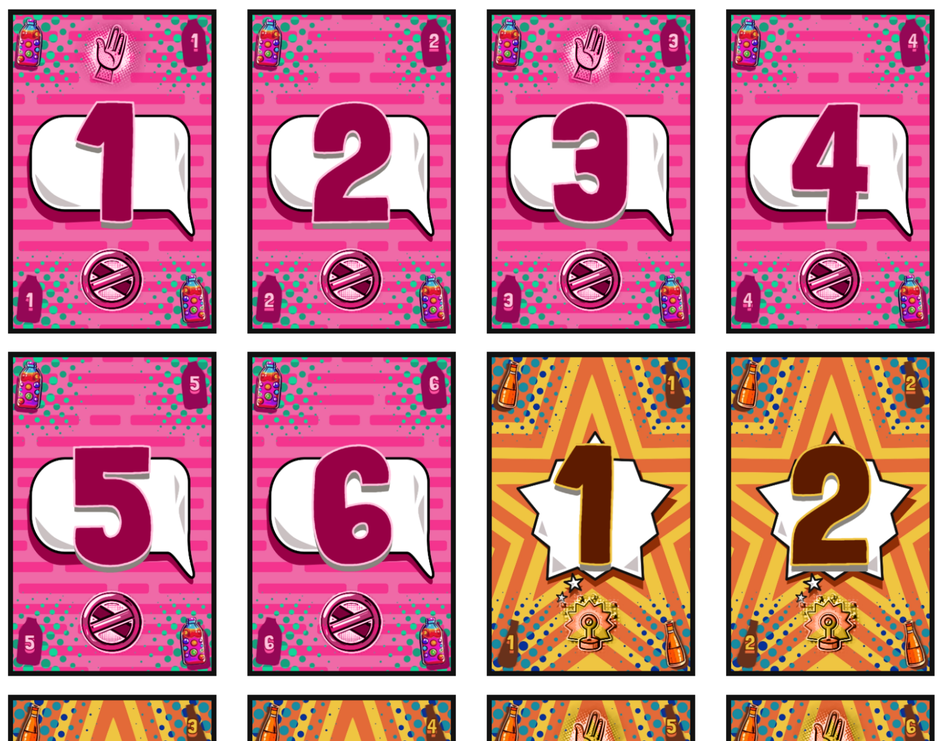

# PQ Games

A framework for **creating generated graphics/visuals** on a website and exporting to **a printable PDF.** 

Focused on one specific use-case: **generating material for print-n-play board games** (cards, tokens, game map, player tableaus, etcetera).

My Pandaqi Games studio website uses this framework to generate a custom print-and-play PDF for most games. It is, therefore, somewhat tailored to my specific use cases. But the framework itself is generic/abstracted and usable in any project.

## How To Use?

Two steps

* Include the library (`src` folder) in your project.
* Call `loadGame` with your desired configuration (somewhere in your script, linked to your desired page).

Check the [Documentation](DOCS.md) for all the details. The configuration you pass into that function decides basically everything. Always look there first for features you need.

@TODO: Export a JS bundle to include statically (with the whole library) and publish as Node package.

## What Can It Do?

What can it _not_ do? ;) 

Built-in functionality for ...

* **Placing material onto pages** (properly spaced, resized, in a grid).
* **Exporting a bundle of pages as a high-resolution PDF.**
* **Drawing complex visuals** (for board game material) using simple functions and settings.
* **Randomly generating and drawing boards** (or "maps") to play on.
* **Exposing a settings UI** to tweak/control the exact configuration that you want to print.
* **Optimization & Batching** that allows heavy workloads without crashing your browser or taking an hour.
* **Two renderers** (Pandaqi/Canvas and Pixi/WebGPU): pick the one for your project and workload. (The one you don't pick is _not_ included in the final bundle to keep it small.)

In the future, the library of visuals might split off into its own submodule, as it's so large and powerful. (In fact, this framework started its life many years ago as "PQ-CANVAS", a library with _only_ functions for drawing onto a canvas.)

## Why?

Long ago, I wanted to offer print-and-play board games for free. But ...

* **Hosting high-resolution PDF files was way too expensive** (to be doing it for free).
* **My laptop was crap and I couldn't just create games in Adobe Illustrator (or similar) anymore**. But my computer could still run _code_ to create visuals and PDFs ...
* My biggest pet peeve with games is that they're set in stone. Most players/playing groups want games to work slightly differently. **By allowing you to input settings and generate your own material, you can design exactly the game you need!**
* I was very excited to **innovate the board game space** with hybrid games (half printed, half digital), games where the massive map you play on is randomly generated, games tailored to your exact age range/group size, and more cool stuff.

So I created a system to easily define board game material, then visualize it, then combine into a nice PDF to instantly print. I was so happy I could finally create games again, and so excited by the possibilities, that I created hundreds of games with it and evolved the system for years.

Since then, many of my inventions have inspired others. They evolved the ideas into something even better. For example, when I launched my first "One Paper Games", they were the _only_ games that you could generate randomly, print, and play with pen on paper. Nowadays there's an entire ecosystem of other designers creating cool games like this (e.g. "Paper Apps")!

I'm not saying this framework is obsolete, but rather that it's _generic_ and was _the first of its kind_. Your specific use case might be better off with a custom system you made yourself (for one specific game) or with different tech stack.

## Roadmap

Check the [Roadmap](ROADMAP.md) for work left to do. The system is very stable (thanks to being used in practice for years), but missing some features or obvious code quality improvements.

I don't expect this system to get another major version or massive changes. My most complex board game ideas simply can't be generated like this _or_ need a custom solution anyway; simpler board game ideas don't _need_ to be this configurable/responsive. The system does what it does, at the right level of complexity, and supports Pandaqi's 100 games, and that's fine.